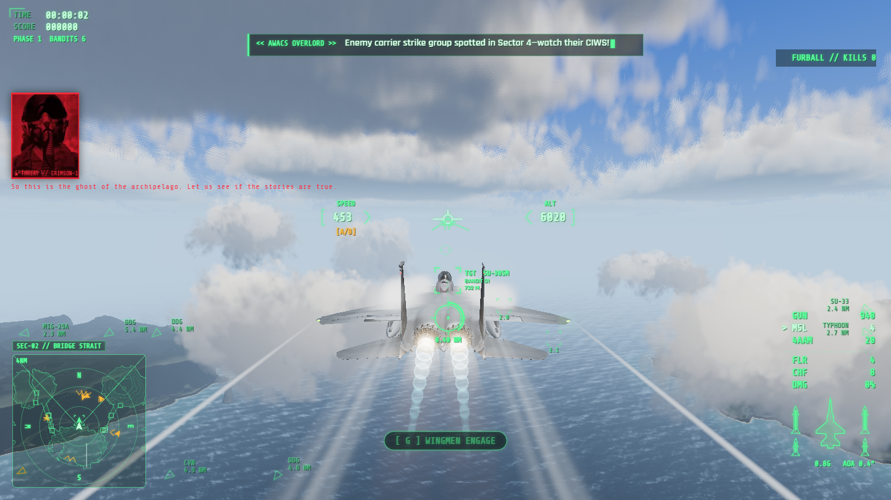
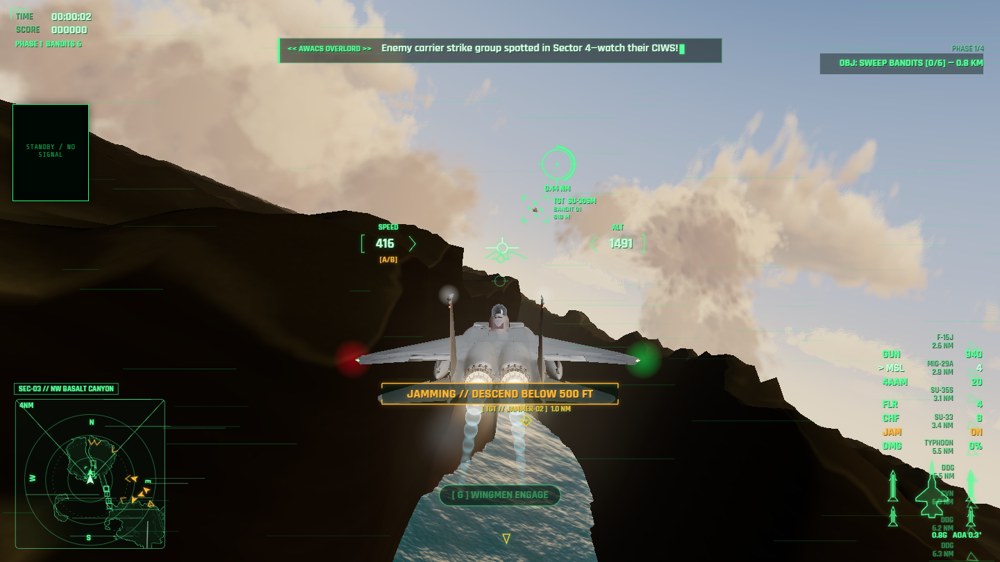
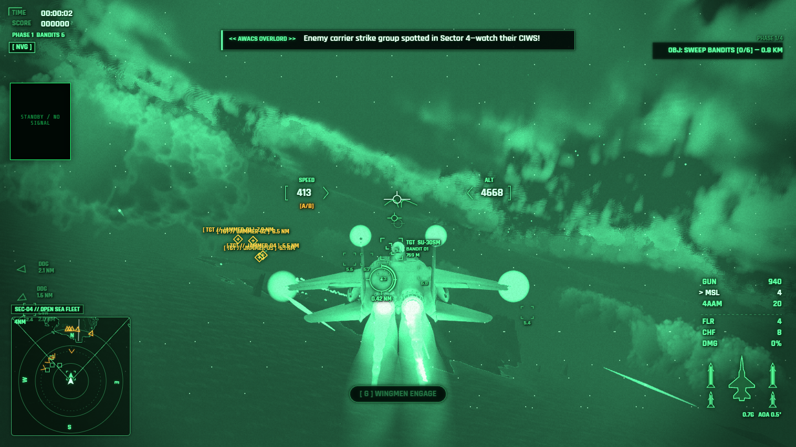
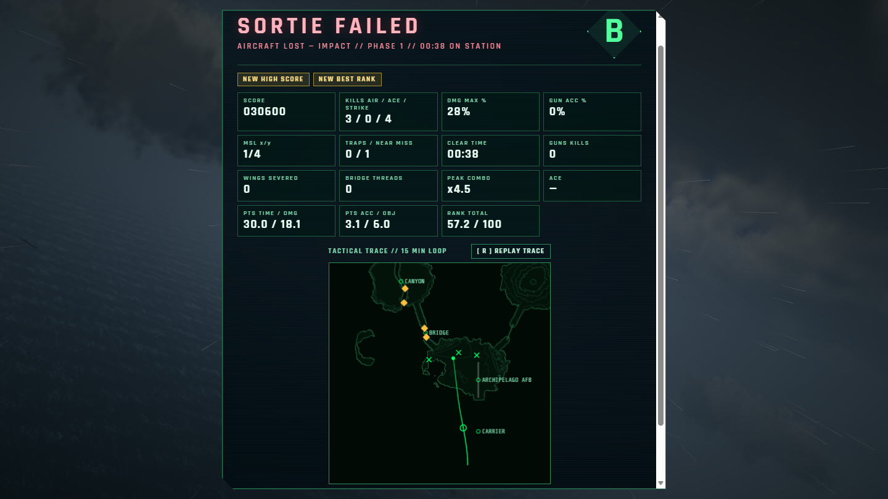

# ANGELS ZERO

**3D F-15C Eagle Tactical Flight, Post-Stall Dogfight & Strike Simulator in the Browser**

[](https://angels-zero.pages.dev/)
[](angel-zero/src/patchnotes.js)
[](https://threejs.org/)
[](#wingmen-voiced-radio-cast--crt-portraits)
[](angel-zero/scripts/prep_f15.py)
[](LICENSE)

**Play Live in Browser:** https://angels-zero.pages.dev/

Take the stick of a **McDonnell Douglas F-15C Eagle** over a 20 km procedural archipelago. Fly a 4-phase air-to-air, canyon strike, Ace intercept, and **CVN carrier recovery** campaign—or drop straight into endless **FURBALL** dogfights—with a decoupled-AoA **Post-Stall Maneuvering (PSM)** flight model, a full **3D first-person F-15C cockpit with cyclable VSD MFDs**, a **45-line voiced radio cast with CRT pilot portraits**, **AN/AVS-9 night vision**, dynamic storms, and an animated **tactical trace debrief**, built cleanly with vanilla ES modules and Three.js r160 with no bundler required.



---

## Screenshots

<table>
  <tr>
    <td width="50%">
      
      <p align="center"><em>Borderless <code>| STANDBY |</code> hangar UI with live F-15C orbit, <code>FLIGHT</code> roster, <code>MISSION BENCHMARK</code>, mode, difficulty, SPW, livery, and weather/time selectors</em></p>
    </td>
    <td width="50%">
      
      <p align="center"><em>First-person 3D F-15C cockpit with collimated combiner HUD, acrylic bubble canopy glass, animated HOTAS, and cyclable VSD MFD sub-pages (<code>[</code> / <code>]</code>)</em></p>
    </td>
  </tr>
  <tr>
    <td width="50%">
      
      <p align="center"><em>Low-altitude canyon &amp; bridge strike run with altitude-gated EW jamming warning, topological sector radar, and HDR bloom</em></p>
    </td>
    <td width="50%">
      
      <p align="center"><em>AN/AVS-9 Night Vision (<code>N</code>) green-phosphor light amplification, contour edge enhancement, and HDR thermal halo bloom</em></p>
    </td>
  </tr>
  <tr>
    <td colspan="2" align="center">
      
      <p align="center"><em>Post-sortie animated <code>TACTICAL TRACE // 15 MIN LOOP</code> map with landmark &amp; combat event icons plus a 100-point composite <code>S / A / B / C</code> rank breakdown</em></p>
    </td>
  </tr>
</table>

---

## Key Features

### Game Modes, Squadron Hangar & 4-Phase Campaign
- **MISSION Mode (4-Phase Campaign)**: Progress seamlessly through four combat phases:
  1. `SWEEP BANDITS` — Air superiority over the Strait and archipelago.
  2. `CANYON/BRIDGE STRIKE` — Destroy 4 hidden jammer bunkers tucked into the NW Basalt Canyon and Bridge Strait piers while staying below `500 ft` inside jammer sectors to prevent lock decay and RWR false paints.
  3. `CRIMSON ACE INTERCEPT` — Engage the two-ship **CRIMSON** ace flight (`SOL-1` / `CRIMSON-1`) using post-stall reversals and aggressive energy tactics.
  4. `CARRIER RTB` — Trap the arrestor wires (`L` gear down below `175 kt`) on allied carrier **CVN-ALLY "OVERLORD"** (with steam catapult turnaround & launch). Live top-right objective card, off-screen chevrons, and contextual prompt pills guide each phase.
- **FURBALL Mode (Instant-Action Sandbox)**: Launch straight from the briefing into a `6,000 ft` / `420 kt` airborne hot start above the cloud sea. Bandits recycle endlessly from the pool with a fresh **CRIMSON** ace pair spawning every `5` kills; press `Tab` twice (or use the Pause menu) to end the sortie and rank on kills per minute.
- **Standby Hangar & Difficulty Presets**: Borderless Ace Combat-style `| STANDBY |` menu floating over the full-viewport F-15C (`Orbit` or `Cockpit` camera preview), `ROOKIE / NORMAL / ACE` difficulty tuning (`src/difficulty.js`), selectable Special Weapons (`4AAM`, `UGB`, `QAAM`), Squadron Liveries (`GHOST`, `ARCTIC`, `GRIMDARK`, `ACE_GOLD` painted onto lead and wingmen), plus unlockable pilot-record liveries (`EAGLE_GREY`, `CIPHER_BLUE`, `MIDNIGHT_STEALTH`, `CRIMSON_VULTURE`).

### 6-DOF Flight Physics, Post-Stall Maneuvering (PSM) & Airframe Articulation
- **Decoupled AoA & Post-Stall Maneuvering (`index.html`)**: Trigger PSM (`B + Shift` below `290 kt` or high-G full stick pull) to unlock **Cobra**, **Kulbit**, and **Hammerhead** maneuvers with over-the-top apex pivot control authority, dense high-AoA condensation vapor, buffet camera shake, style combo scoring, and maneuver callouts—plus recoverable **flat spins** on sustained stall + rudder/opposite-roll input.
- **Articulated F-15C & Mechanical Systems**: Normalized `19.4 m` GLB airframe (`src/surfaces.js` + `src/gear.js`) featuring hinged `Ctrl_*` stabilators, supersonic aileron lockout (`M0.95–M1.05`), auto-droop flaps, rudders, dorsal speedbrake (`B`), Mach-scheduled intake ramps, dilating twin F100 exhaust nozzles, retractable forward-swinging tricycle landing gear (`L`), Prandtl-Glauert Mach 1 vapor cone + sonic boom, pilot G-LOC greyout/blackout, and single-engine fire damage with Halon bottle extinguish (`F`) and windmill relight attempts.

### 3D First-Person F-15C Cockpit, VSD MFDs & Bubble Canopy Glass
- **Reference-Matched 3D Cockpit (`src/cockpit3d.js`)**: Procedural `2048x2048` crinkle-coat textures, enclosed tub, beveled canopy bow with bolts/locks/handles, ribbed glare shield, Up-Front Controller (UFC), 16-dial live analog instrument atlas, 3D ADI ball, amber 3×13 caution matrix, animated HOTAS stick + split `Throttle_L/R`, curved combiner HUD glass, NVG instrument dimming, and decoupled pilot-head G/roll inertia.
- **Cyclable VSD MFD Sub-Pages (`[` / `]`)**: Switch the left VSD CRT live in first person between **Tactical Radar** (`10 NM` sweep plotting wingmen, bandits, aces, and strike bunkers), **Stores & Damage** (F-15 wireframe, engine fire status, ammo, countermeasures), and **RWR Threat Scope**.
- **Tangible 3D Bubble Canopy Glass & Free-Look (`src/canopyglass.js`, `src/freelook.js`)**: Curved acrylic canopy shader with dual GGX sun glare arcs, polycarbonate Fresnel sheen, micro-scratches, emerald HUD bounce, and airspeed/roll-deflected sliding rain & cloud-mist droplets. Hold `Alt` or `Middle-Click` for spring-return free-look (`±150°` in cockpit, `360°` chase orbit).

### Wingmen, Voiced Radio Cast & CRT Portraits
- **Warden Flight & Crimson Aces**: **WARDEN-2** and **WARDEN-3** fly echelon formation (`G` toggles formation/engage), confirm kills, and share your selected squadron livery. **CRIMSON** aces arrive with threat warnings and can fly visual Cobra/Kulbit reversals.
- **45-Line Radio Voice Cast & CRT Portraits (`src/radioScript.js`, `assets/portraits/`)**: Band-pass filtered MP3 transmissions across `AWACS OVERLORD`, `WARDEN-2`, `WARDEN-3`, and `CRIMSON-1` driven by a priority dispatcher (interrupting critical alerts, queuing tactical calls, gating banter, ducking music & combat SFX) paired with phosphor **CRT pilot portraits** (emerald phosphor for friendlies, crimson `#FF2A3B` threat frame for Crimson aces) with text fallback.
- **Adaptive Soundtrack & Procedural Web Audio (`src/audio.js`)**: Three-layer adaptive combat score (`PATROL` / `FURBALL` / `ACE`), synthesized twin F100 turbines + afterburners, 100 Hz M61A1 Vulcan, AIM-9 seeker growl/lock, ALR-56C RWR chirps, ALQ-135 ECM buzz, missile flyby pressure pulses, and G-LOC audio tunnel (`src/audio.js` + supplemental CC0 SFX in `assets/sfx/`).

### Weapons, Dynamic Weather, NVG & Tactical Trace Debrief
- **Ordnance & Countermeasures (`src/combat.js`)**: `940`-round `M61A1` 20mm Vulcan with barrel heat, gun funnel, 4-step LCOS reticle, and localized wing severance; `AIM-9M` IR Sidewinders; `4AAM` track-while-scan multi-lock ripple; high-off-boresight `QAAM`; and `MK-82 UGB` (`CCIP` / `CCRP`) producing Pass 5 HDR bloom fireballs, shockwave rings, arcing debris, hanging soot plumes, and water geysers (`src/blastfx.js`). Includes hold-to-track **Missile Cam** (`RMB` / `M`), ace/close-gun kill slow-mo, `X` flares, `Z` chaff + radar notching, `J` ALQ-135 ECM jammer, and `E` rocket-seat ejection bailout.
- **Dynamic Atmosphere, Weather & Night Vision (`src/atmosphere.js`, `src/weather.js`, `src/nvg.js`)**: Five time-of-day presets (`CLOUD SEA`, `DAWN`, `DAYLIGHT`, `GOLDEN HOUR`, `DUSK`, `NIGHT`) and five weather states (`CLOUD_SEA`, `CLEAR`, `SCATTERED`, `OVERCAST_RAIN`, `THUNDERSTORM` with lightning flashes, thunder, wind chop, and gust buffeting) paired with raymarched volumetric sky clouds + cumulus banks and **AN/AVS-9 Night Vision (`N`)**.
- **Animated Tactical Trace Debrief (`src/telemetry.js`)**: Records sortie flight path and combat events into fixed `Float32Array` buffers and replays an animated topological trace map (`KILL`, `ACE`, `STRIKE`, `TRAP`, `NEAR MISS`) alongside a 100-point composite **S / A / B / C** rank breakdown (`R` replays the trace).

---

## Controls Reference

### Flight
| Input | Action |
| :--- | :--- |
| **Mouse** | Pitch / roll (rate-command stick) |
| **W / S** | Throttle up / down (airbrake) |
| **Shift** | Afterburner (`Shift` or `W+S` while pulling = High-G turn; `B+Shift` < `290 kt` = PSM) |
| **A / D** | Rudder yaw (tap = nudge, hold = full; steer parachute after ejection) |
| **Q** | Evasive `360°` barrel roll |
| **B** | Dorsal speedbrake / wheel brakes (and PSM entry with `Shift` < `290 kt`) |
| **L** | Landing gear up / down |

### Combat & Wingmen
| Input | Action |
| :--- | :--- |
| **Left-Click / F** | M61A1 20mm Vulcan cannon (if engine fire: `F` fires Halon extinguisher, hold `F` attempts windmill relight) |
| **Right-Click / M** | Fire selected weapon (`>MSL` / `4AAM` / `QAAM` / drop `>UGB`; hold to track Missile Cam) |
| **R · 1 / 2 / 3** | Cycle or directly select `MSL` / `SPW` (`4AAM` / `UGB` / `QAAM`) |
| **C** | Lock missile seeker / cycle target inside sight cone (auto-radar designates forward bandits) |
| **X** | Deploy IR decoy flares (`FLR`) |
| **Z** | Dispense radar chaff (`CHF`) |
| **J** | Activate ALQ-135 ECM jammer |
| **G** | Wingmen command: toggle formation / engage (`WARDEN-2` & `WARDEN-3`) |

### Camera, Avionics & Systems
| Input | Action |
| :--- | :--- |
| **Space** | Toggle 1st-person 3D Cockpit / 3rd-person Chase camera |
| **Alt / Middle-Click** | Free Look (hold + drag mouse; springs back on release) |
| **[ / ]** | Cycle 3D Cockpit VSD MFD page (`TACTICAL RADAR` / `STORES & DMG` / `RWR THREAT SCOPE`) |
| **N** | Toggle AN/AVS-9 Night Vision (NVG) |
| **K** | Toggle adaptive combat music |
| **F1** | Toggle compact in-flight keybind cheat-sheet |
| **Tab Tab** *(2x)* | End sortie cleanly & open Tactical Trace Debrief |
| **E** | Eject (rocket seat, steerable parachute) |
| **H / Esc** | Open `| PAUSED |` menu / Controls & Audio settings |
| **Backspace** | Reset aircraft |
| **↑↓ / ←→ / Enter** *(Menus)* | Navigate & cycle `| STANDBY |` rows (`R` in Debrief replays trace) |

---

## Quick Launch (Local)

Serve over HTTP (required for ES modules, Web Audio clips, and GLB loading).

### Windows
Double-click **`launch.bat`** in the repository root. It starts the local HTTP server (`server.py` or `npx serve`) and opens the game in your browser.

### macOS / Linux
```bash
chmod +x launch.sh
./launch.sh
```

### Manual Launch (Python 3)
```bash
python server.py
```
Serves `angel-zero/` at `http://127.0.0.1:8090/` (auto-selecting the next available port up to `8109` if busy) with `Cache-Control: no-store`.

---

## Repository Structure

```text
.
├── .github/workflows/deploy.yml   # Cloudflare Pages deployment from angel-zero/
├── angel-zero/                    # Deployable site root (served at angels-zero.pages.dev)
│   ├── index.html                 # Orchestrator: renderer, ocean, 6-DOF + PSM physics, STANDBY/Debrief UI
│   ├── src/
│   │   ├── atmosphere.js          # Sky dome, corona, fog sync, DAWN/DAYLIGHT/GOLDEN_HOUR/DUSK/NIGHT presets
│   │   ├── audio.js               # Procedural F100/Vulcan/RWR/3-layer music DSP + MP3 SFX & radio playback
│   │   ├── blastfx.js             # Visual Pass 5 pooled HDR fireballs, shockwaves, debris, soot, water geysers
│   │   ├── canopy.js              # 2D peripheral camera mist streaks & post-cloud moisture film
│   │   ├── canopyglass.js         # 3D bubble canopy GGX glare, Fresnel sheen & sliding rain/mist shader
│   │   ├── cockpit3d.js           # 3D F-15C cockpit, crinkle-coat maps, 16-dial atlas, 3-page VSD MFD, HOTAS
│   │   ├── combat.js              # 4-phase campaign, FURBALL, Crimson aces, Warden flight, CVN carrier, ordnance
│   │   ├── difficulty.js          # ROOKIE / NORMAL / ACE persisted combat & sensor presets
│   │   ├── eject.js               # Rocket seat bailout, steerable 16-gore parachute, burning wreck
│   │   ├── freelook.js            # Hold Alt / MMB pointer-locked cockpit & 360 chase orbit look
│   │   ├── gear.js                # Procedural articulated tricycle landing gear & forward retraction
│   │   ├── hud.js                 # Hi-DPI phosphor HUD, combiner projection, topo radar, LCOS, CCIP, prompts
│   │   ├── livery.js              # Non-recompiling shader livery painter for player & wingmen
│   │   ├── loadout.js             # Persisted MISSION/FURBALL mode, 4AAM/UGB/QAAM SPW & squadron liveries
│   │   ├── nvg.js                 # Half-float HDR UnrealBloomPass & AN/AVS-9 Gen-3 green-phosphor NVG shader
│   │   ├── patchnotes.js          # Structured release log (v0.9.0–v1.1.3) & build version chip source
│   │   ├── profile.js             # Persisted pilot service record, rank thresholds & unlockable liveries
│   │   ├── radio.js               # Reactive tactical radio queue & subtitle timing
│   │   ├── radioScript.js         # 45 scripted radio lines across AWACS, WARDEN-2/3 & CRIMSON-1
│   │   ├── surfaces.js            # Hinged Ctrl_* deflections, M0.95–1.05 aileron lockout, F100 nozzles
│   │   ├── telemetry.js           # Allocation-free Float32Array flight trace & combat event buffer
│   │   ├── vfx.js                 # Mach-diamond AB, contrails, vapor cone, sea spray, hybrid volumetric clouds
│   │   ├── weather.js             # CLOUD_SEA / CLEAR / SCATTERED / OVERCAST_RAIN / THUNDERSTORM + lightning
│   │   └── world.js               # 20x20 km archipelago heightfield, airbase, canyon, volcano, bridges, atolls
│   ├── assets/
│   │   ├── portraits/             # 6 CRT phosphor pilot & AWACS portraits (128x160 .webp, < 20 KB total)
│   │   ├── sfx/                   # Supplemental CC0 audio textures + CREDITS.md
│   │   ├── voicelines/radio/      # 45 mono radio-filtered MP3 voice clips (0.92 MB total) + README.md
│   │   ├── angels_zero_jet.glb    # Normalized 19.4 m F-15 Eagle GLB (11.5 MB, 16 ordnance nodes)
│   │   └── f15_prep_report.json   # Automated Blender prep & ordnance report
│   ├── scripts/
│   │   ├── prep_f15.py            # Headless Blender 5.3 pipeline (source of truth for F-15 GLB)
│   │   ├── make_portraits.py      # Generates the 6 phosphor CRT webp portraits
│   │   ├── radio_voice_pass.py    # Generates the 45 radio-filtered MP3 clips via Voicebox/Kokoro
│   │   └── build_jet.py           # Retired Step 1A procedural jet generator (reference)
│   ├── PLAN.md                    # Development roadmap, milestone log & debug flags
│   └── AGENTS.md                  # Asset pipeline conventions & build rules
├── docs/screenshots/              # Gameplay screenshots for README
├── launch.bat / launch.sh         # One-click local launchers
├── server.py                      # Zero-dependency local HTTP server for angel-zero/
├── PROJECT.md                     # Technical architecture & asset pipeline docs
├── CLAUDE.md                      # Developer commands & release checklist
└── LICENSE                        # MIT License
```

For architecture invariants, Blender/portrait/voice asset pipelines, and headless test query flags (`?debug`, `?warp`, `?cockpit`, `?psm`, `?debriefat`, etc.), see [PROJECT.md](PROJECT.md) and [angel-zero/PLAN.md](angel-zero/PLAN.md).

---

## License

Released under the [MIT License](LICENSE).
