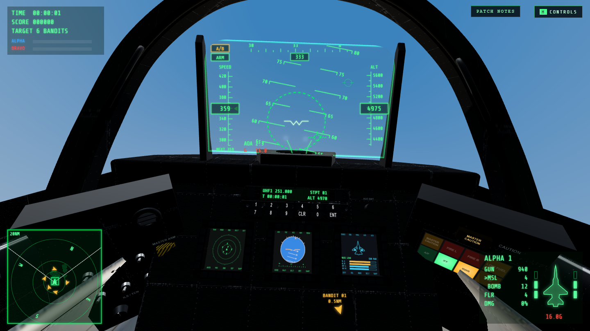
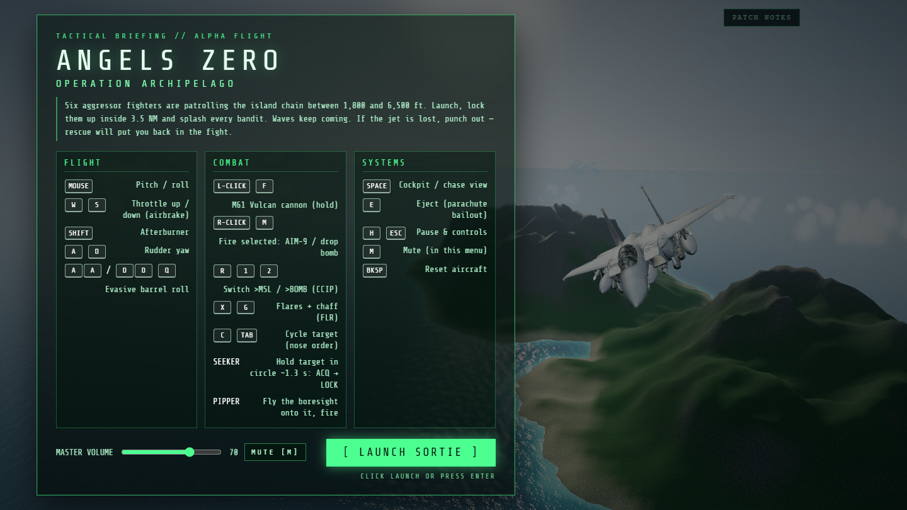

# ANGELS ZERO

**3D F-15 Eagle Tactical Flight & Dogfight Simulator in the Browser**

[](https://angels-zero.pages.dev/)
[](https://threejs.org/)
[](#zero-asset-procedural-web-audio)
[](angel-zero/scripts/prep_f15.py)
[](LICENSE)

**Play Live in Browser:** https://angels-zero.pages.dev/

Take the stick of a **McDonnell Douglas F-15 Eagle** over a 20 km procedural archipelago. Engage six-ship aggressor waves in a 6-DOF rate-command flight model with a full **3D first-person F-15C cockpit**, **world-conformal combiner HUD**, **M61A1 Vulcan cannon**, **progressive IR AIM-9 Sidewinders**, **CCIP free-fall bombing**, **flares & chaff**, **ejection seat bailouts**, and a **100% procedural Web Audio synthesizer** — built with vanilla ES modules and Three.js with no bundler required.


---

## Screenshots

<table>
  <tr>
    <td width="50%">
      
      <p align="center"><em>First-person 3D F-15C cockpit with collimated combiner HUD, pilot-head inertia, and live TEWS / ADI / Stores MFDs</em></p>
    </td>
    <td width="50%">
      
      <p align="center"><em>Sortie briefing overlay with live orbiting F-15 over the 20 km archipelago</em></p>
    </td>
  </tr>
</table>

---

## Key Features

### 6-DOF Rate-Command Flight Model & Atmospheric VFX
- **Normalized F-15 Eagle Airframe**: 19.4 m length, 13.4 m wingspan, gear-stripped and solidified GLB asset with 16 individually separated pylon stores (`4` wing-rail missiles and `12` conformal-tank bombs).
- **Snappy Arcade-Sim Handling**: Rate-command mouse stick (`3.4 rad/s` roll, `1.85 rad/s` pitch, `1.1 rad/s` rudder) with coordinated bank-to-turn yaw, velocity-vector grip tuned around `330 kt` corner speed, high-G turn boost (`W+S` or `Shift` + hard pull, `1.45x` pitch rate), and scripted `360°` evasive barrel rolls (`Q` or double-tap `A`/`D`).
- **Real-Time Aerodynamic & Ocean Shaders**:
  - Custom GLSL Mach-diamond shock-oscillating afterburner plumes.
  - Camera-facing wingtip contrail ribbons and over-wing condensation vapor in high-G pulls.
  - Supersonic speed streaks and Prandtl-Glauert vapor cone when crossing Mach `1.0`.
  - Low-altitude sea spray below `150 ft` AGL and a single-draw-call instanced cloud layer (`2,500–5,500 ft`) that mists the canopy and thickens fog on fly-through.
  - 20 km 11-island archipelago with depth-mapped turquoise shallows, animated surf, and dual-normal specular ocean shaders.

### 3D First-Person F-15C Cockpit & World-Conformal HUD
- **Procedural 2048² Crinkle-Coat Cockpit**: Built in `src/cockpit3d.js` with diffuse, normal, and roughness maps (stipple grain, panel seams, brushed edge wear, and countersunk rivets), enclosed forward tub, beveled canopy bow with 16 hex bolts, lock hooks, grab handles, ribbed glare shield, and cockpit sun shadows.
- **Decoupled Pilot-Head Dynamics**: Canopy bow and combiner swing up to `11°` ahead of the pilot's head in fast rolls, eyes look into turns (`+14°` pitch / `12°` yaw), plus G compression and afterburner/airbrake fore-aft head shifts while keeping HUD symbology world-conformal.
- **Live Avionics & MFDs**:
  - Curved `MeshPhysicalMaterial` combiner glass projecting conformal pitch ladder, horizon cardinals, velocity vector (FPV), `SPEED` (`NEXT` 5 s trend caret) and `ALT` tapes, heading compass, and `A/B` / `ARM` tags.
  - Up-Front Controller (UFC) LED readout + 12-key keypad, three recessed MFDs with 60 bezel OSBs (**TEWS Threat Scope** at 20 Hz, **ADI + Tactical Heading**, **Stores + NL/EGT Engine Gauges**), and a right-console backlit **Annunciator** + flashing **Master Caution** push-light.

### Dogfighting, Strike Ordnance & Countermeasures
- **M61A1 20mm Vulcan Cannon (`L-Click` / `F`)**: Starboard wing-root port harmonized to `1,500 ft` (`940` rounds, `6,000 rpm`, `1,050 m/s`, `8 mrad` dispersion) with gold-to-amber velocity tracers, cordite smoke, own-rate-bending **HUD gun funnel**, and 4-step iterative **LCOS lead reticle** (`SHOOT` cue inside `0.6 NM`).
- **Progressive IR Seeker & AIM-9 Sidewinders (`R-Click` / `M`)**: Cycle targets in nose-alignment order with `C` / `Tab`. Hold a bandit inside the `14°` seeker circle and `3.5 NM` for `1.3 s` (`SCAN` → `ACQ` amber rotating diamond → `LOCK` red pulsing diamond). Launches clone the real wing-pylon GLB store and fly turn-rate-limited proportional navigation (`N = 4.2`, `34°/s` on full lock).
- **CCIP Free-Fall Bombing (`R` / `1` / `2` → `>BOMB`)**: Switch to air-to-ground ordnance to drop 12 conformal-tank bombs (`Pylon_BOMB_1..12`) guided by an exact closed-form ballistic **CCIP fall line and impact pipper**, producing water geysers, ground fireballs, and shockwave rings (`70 m` blast radius).
- **Flares, Chaff & Evasive AI (`X` / `G`)**: Six-ship aggressor waves run `PATROL`, `PURSUE`, and 9 G `EVADE` behaviors, locking the player's rear hemisphere (`RWR TRACK` / `MISSILE ALERT`) and firing red-smoke missiles. Dispense magnesium flare + chaff salvos (`X` / `G`) or break-roll inside `900 m` to break locks and decoy inbound missiles.
- **Ejection & Rescue Respawn (`E`)**: Manual bailout, `0 HP`, or ground/sea contact fires the rocket seat, deploys a steerable 16-gore orange/white parachute (`0.7 s`) with pendulum sway while your burning jet spirals in, and inserts a fresh F-15 at `4,500 ft` after `5.0 s`.

### Zero-Asset Procedural Web Audio
No external MP3/WAV files are downloaded or played. `src/audio.js` synthesizes everything live in Web Audio API:
- Twin F100 turbine pink/brown noise + dual detuned sawtooth whine + afterburner rumble/crackle with cockpit canopy low-pass muffling (`2.6 kHz`).
- M61A1 `BRRRT`: 100 Hz inverted-saw LFO-chopped white/pink noise (`±3 Hz` flutter) routed into high-pass tear, `1.1 kHz` waveshaped gunpowder crack, `140 Hz` `+8 dB` airframe thump (`+6 dB` at `120 Hz` in cockpit), and a `0.55 s` convolver air-echo tail.
- AIM-9 seeker growl (`SCAN` / pulsed `ACQ` / `950 Hz` `LOCK`), dual-tone `1200/800 Hz` RWR alert, bomb-rack hook clunk, pitch-sliding falling-bomb whistle, sub-bass detonations, and staggered flare cartridge pops/sizzle.

---

## Controls Reference

### Flight
| Input | Action |
| :--- | :--- |
| **Mouse** | Pitch / roll (rate-command stick) |
| **W / S** | Throttle up / down (airbrake) |
| **Shift** | Afterburner (`W+S` or `Shift` + hard pull = High-G turn) |
| **A / D** | Rudder yaw (and parachute steering after ejection) |
| **AA / DD / Q** | Evasive `360°` barrel roll |

### Combat
| Input | Action |
| :--- | :--- |
| **Left-Click / F** | M61A1 Vulcan 20mm cannon (hold) |
| **Right-Click / M** | Fire selected weapon (`>MSL` AIM-9 / drop `>BOMB`) |
| **R / 1 / 2** | Switch `>MSL` / `>BOMB` (CCIP) |
| **X / G** | Dispense flares + chaff salvo (`FLR`) |
| **C / Tab** | Cycle designated target (nose-alignment order) |

### Systems
| Input | Action |
| :--- | :--- |
| **Space** | Toggle 3D Cockpit / Chase camera |
| **E** | Eject (parachute bailout & rescue respawn) |
| **H / Esc** | Pause & open controls / audio settings |
| **M** *(in Menu/Pause)* | Mute / unmute audio |
| **Backspace** | Reset aircraft |
| **Enter** *(in Menu/Pause)* | Launch / resume sortie |

---

## Quick Launch (Local)

Serve over HTTP (required for ES modules and GLB loading).

### Windows
Double-click **`launch.bat`** in the repository root. It starts the local HTTP server (`server.py` or `npx serve`) and opens the game in your browser.

### macOS / Linux
```bash
chmod +x launch.sh
./launch.sh
```

### Manual Launch (Python 3)
```bash
python server.py
```
Serves `angel-zero/` at `http://127.0.0.1:8090/` (auto-selecting the next available port up to `8109` if busy) with `Cache-Control: no-store`.

---

## Repository Structure

```text
.
├── .github/workflows/deploy.yml   # Cloudflare Pages deployment from angel-zero/
├── angel-zero/                    # Deployable site root
│   ├── index.html                 # Game shell, archipelago world, 6-DOF physics, menu & GLB loader
│   ├── src/
│   │   ├── cockpit3d.js           # 3D F-15C cockpit, crinkle-coat textures, live MFDs, head dynamics
│   │   ├── hud.js                 # Chase HUD & combiner-clipped cockpit HUD, radar, LCOS, CCIP
│   │   ├── combat.js              # 6-ship bogey AI, M61A1, AIM-9 PN, bombs, flares & particles
│   │   ├── vfx.js                 # Mach-diamond plumes, contrails, vapor, Mach cone, spray, clouds
│   │   ├── eject.js               # Seat rocket arc, steerable 16-gore chute, wreck & respawn
│   │   └── audio.js               # 100% procedural Web Audio synthesizer
│   ├── assets/
│   │   ├── angels_zero_jet.glb    # Normalized 19.4 m F-15 Eagle GLB (11.5 MB, 16 ordnance nodes)
│   │   └── f15_prep_report.json   # Automated Blender prep & ordnance report
│   ├── scripts/
│   │   ├── prep_f15.py            # Headless Blender 5.3 pipeline (source of truth for the F-15 GLB)
│   │   └── build_jet.py           # Retired Step 1A procedural stealth-jet generator (reference)
│   ├── PLAN.md                    # Development milestone log & debug query flags
│   ├── AGENTS.md                  # Asset pipeline conventions & build workflow
│   └── prototype_flight_index.html# Preserved v1.1 prototype
├── docs/screenshots/              # Gameplay screenshots for README
├── launch.bat / launch.sh         # One-click local launchers
├── server.py                      # Zero-dependency local HTTP server for angel-zero/
├── PROJECT.md                     # Technical architecture & Blender asset pipeline docs
└── LICENSE                        # MIT License
```

For architecture contracts, Blender GLB regeneration instructions, and headless test query flags (`?debug`, `?warp`, `?cockpit`, etc.), see [PROJECT.md](PROJECT.md) and [angel-zero/PLAN.md](angel-zero/PLAN.md).

---

## License

Released under the [MIT License](LICENSE).
